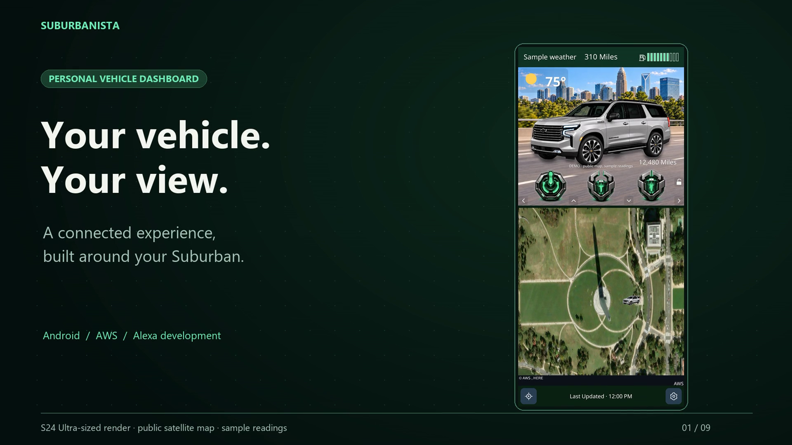
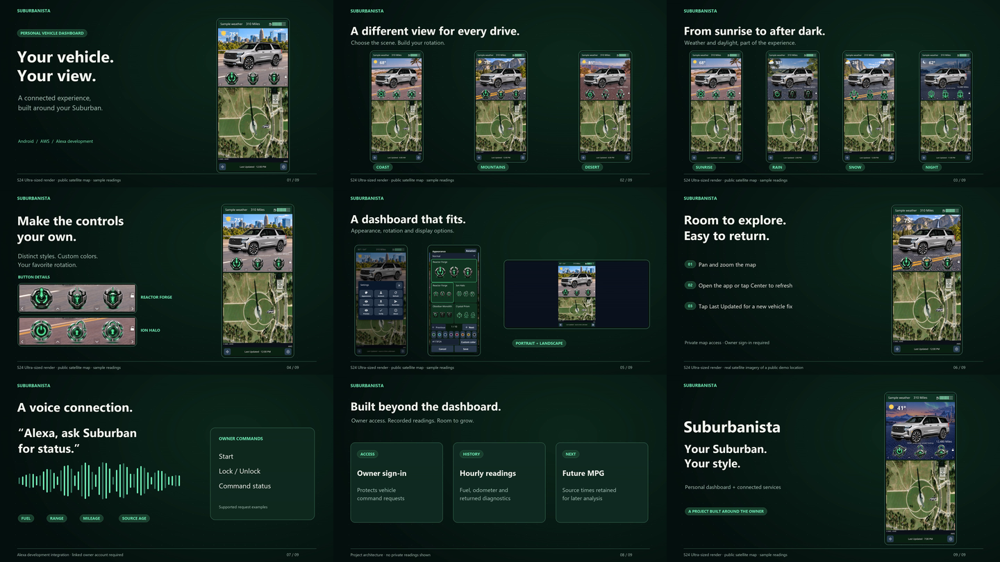

# Suburbanista project showcase

- [Download the narrated 1080p promo video](suburbanista-promo-1080p.mp4) — 2 minutes 16 seconds, with Higgsfield Juno narration, music, and embedded English captions. Playback is 20% faster than the previous version.
- [Caption file](suburbanista-promo.srt)
- [Screenshot gallery](screenshots-s24-ultra/gallery.html) — download this directory and open the HTML file locally to browse it.
- [Screenshot files](screenshots-s24-ultra/rendered) — 20 freshly rendered app screens: 1440 × 3120 portrait and 3120 × 1440 landscape, matching Samsung Galaxy S24 Ultra proportions.

The video covers scenery, weather, time of day, button styles, settings, display options, maps, vehicle requests, hourly readings, and Alexa integration.

The map is real AWS satellite imagery of the public National Mall demonstration area, with provider credits retained. Vehicle readings and the vehicle marker are demonstration values. These are fresh app renders at S24 Ultra proportions, not physical S24 captures or stretched S9 images. Private location captures are excluded. Alexa is a linked-account development integration, not a public Skills Store release. No physical vehicle commands were sent to create this showcase.

The video uses user-selected Higgsfield Juno narration, an original synthesized score, and current app visuals. The complete edit plays at 1.2× speed with voice pitch preserved and captions retimed to match. Full audio/video decoding and visual checks passed. Format, provenance, and the SHA256 checksum are in [video-verification.json](video-verification.json).

